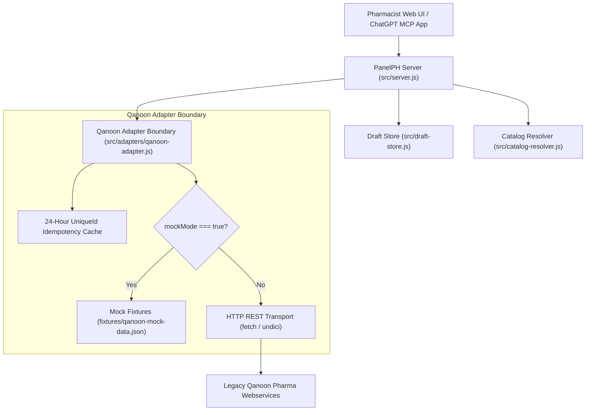
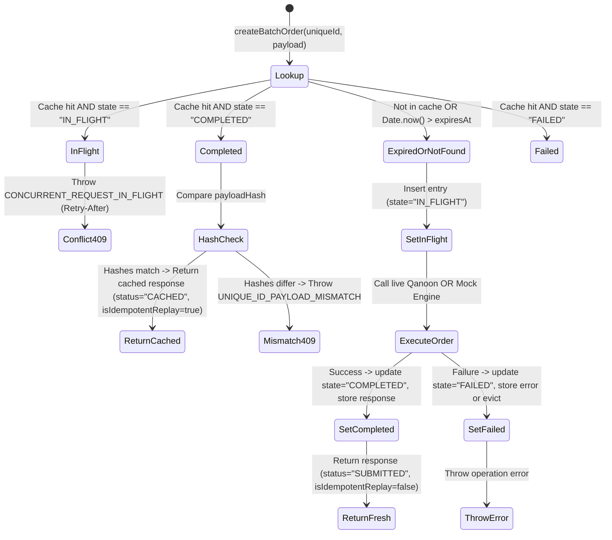

# Specification Plan: Qanoon REST API Spec & 24-Hour Idempotency Cache

**Document Version:** 1.0.0  
**Author:** m1_spec_miner_3 (Qanoon API Spec & Idempotency Miner)  
**Target Repository:** `/home/admin/PanelPH`  
**Milestone:** Milestone 1 — Qanoon Adapter & Docs  
**Deliverable Targets:**  
- `docs/qanoon-api-spec.md`  
- `src/adapters/qanoon-adapter.js` (Idempotency Cache Engine & Public Interface)  
- `fixtures/qanoon-mock-data.json`  
- `test/qanoon-adapter.test.js`  

---

## 1. Executive Summary & Specification Authorities

This document establishes the authoritative technical blueprint for:
1. The formal specification document to be authored at `docs/qanoon-api-spec.md`.
2. The 24-hour `uniqueId` idempotency cache and adapter interface to be implemented in `src/adapters/qanoon-adapter.js`.
3. The offline mock fixture requirements and automated test contracts.

### Authoritative Reference Sources
- **`ORIGINAL_REQUEST.md` (R1 & Acceptance Criteria)**: Mandates isolated Qanoon adapter boundary (`src/adapters/qanoon-adapter.js`), documentation in `docs/qanoon-api-spec.md`, 24-hour `uniqueId` retry semantics, and 100% offline reproducible test execution using mock fixtures without live network dependencies.
- **`PROJECT.md` (Architecture & Interface Contracts)**: Prescribes exact public method signatures for `QanoonAdapter`: `checkStock`, `calculatePrice`, `createBatchOrder`, and `searchGoods`.
- **`ADR-002-qanoon-authorized-source-access.md`**: Enforces strict isolation boundary. Domain logic never couples to raw Qanoon schemas; zero credentials or live endpoints in repository; read-only prototyping; changes to live inventory forbidden in test/staging.
- **`survey_spec_miner_2/spec_report.md`**: Provides extracted legacy webservice definitions, JSON schemas, 7-step deterministic pricing sequence, 75/25 VAT/toll split, and leading-zero code preservation rules.
- **Reference Implementation (`/home/admin/projects/Bale-Med-Prices`)**: `calculate-final-price.ts`, `calculate-tax.ts`, and `calculate-profit.ts` confirming exact math, tax date matching, technical fee exclusion for non-pharma items, and >10,000 Rial TTAC divergence warning.

---

## 2. Complete Blueprint for `docs/qanoon-api-spec.md`

The file `docs/qanoon-api-spec.md` must be a self-contained, enterprise-grade API reference document containing the following 8 sections:

### Section 1: Architecture Overview & Isolation Boundary
- **System Role**: Bridges PanelPH pharmacy operational draft desk with legacy Qanoon pharmacy management systems.
- **Decoupled Boundary**: PanelPH domain code (`draft-store.js`, `server.js`) interacts exclusively with `src/adapters/qanoon-adapter.js`. No raw Qanoon network calls or data structures leak into PanelPH core.
- **Mock Mode / Offline First**: Default mode is `mockMode: true` reading from `fixtures/qanoon-mock-data.json`. Live network mode is strictly opt-in via environment variables (`QANOON_LIVE_URL`, `QANOON_API_KEY`, `QANOON_PHARMACY_ID`). Zero credentials permitted in repo.
- **System Architecture Diagram (Mermaid)**:


### Section 2: Transport, Protocols & Authentication Headers
- **Transport**: HTTPS (or HTTP/1.1 over secure LAN)
- **Content-Type**: `application/json; charset=utf-8`
- **Headers**:
  | Header Name | Type | Mandatory? | Description |
  |---|---|---|---|
  | `Authorization` | String | Yes (Live) | `Bearer <API_KEY>` or API Key |
  | `X-Pharmacy-Id` | String | Yes | Unique pharmacy license identifier (e.g. `PHARM-TEH-0084`) |
  | `X-Client-Id` | String | No | Client application tag (defaults to `panelph-desk`) |
  | `X-Request-Id` | String | Yes | UUIDv4 per-request tracing identifier |
  | `X-Unique-Id` | String | Yes (for `/orders/batch`) | Idempotency token for state-mutating batch requests |

### Section 3: Endpoint — Stock Availability Check (`POST /api/v1/stock/check`)
- **Route**: `POST /api/v1/stock/check` (Single item fallback: `GET /api/v1/stock/:goodId`)
- **Purpose**: Query real-time available stock, batch expiration dates, and weighted average cost across pharmacy warehouses.
- **Two-Stage Check Lifecycle**:
  1. *Stage 1 (Advisory Check)*: Invoked when a draft need is resolved against the catalog. Displays informative badges (`in_stock`, `low_stock`, `out_of_stock`).
  2. *Stage 2 (Pre-Export Barrier)*: Invoked immediately before batch creation. Fails if requested count > available count.
- **Request Schema (JSON)**:
```json
{
  "$schema": "http://json-schema.org/draft-07/schema#",
  "title": "StockCheckRequest",
  "type": "object",
  "required": ["warehouseId", "items"],
  "properties": {
    "warehouseId": { "type": "string", "default": "main" },
    "items": {
      "type": "array",
      "minItems": 1,
      "items": {
        "type": "object",
        "required": ["genericCode", "quantity"],
        "properties": {
          "goodId": { "type": "string" },
          "genericCode": { "type": "string", "description": "National Drug List code preserving leading zeros (e.g. '00001')" },
          "brandCode": { "type": "string", "description": "Brand manufacturer code preserving leading zeros" },
          "quantity": { "type": "integer", "minimum": 1 }
        }
      }
    }
  }
}
```
- **Response Schema (JSON) — 200 OK**:
```json
{
  "warehouseId": "main",
  "checkedAt": "2026-10-14T09:30:00.000Z",
  "allAvailable": true,
  "items": [
    {
      "goodId": "g-1001",
      "genericCode": "00001",
      "brandCode": "00001",
      "requestedQuantity": 2,
      "availableCount": 140,
      "isAvailable": true,
      "stockStatus": "in_stock",
      "earliestExpDate": "2027-02-01",
      "avgCost": 132000,
      "unitLabel": "capsule"
    }
  ]
}
```

### Section 4: Endpoint — Deterministic Price Calculation (`POST /api/v1/pricing/calculate`)
- **Route**: `POST /api/v1/pricing/calculate`
- **Purpose**: Execute 7-step deterministic price calculation factoring base retail prices, dated tax/toll schedules (75/25 VAT/toll split), technical dispensary fees, and TTAC divergence warnings.
- **Calculation Sequence**:
  1. `unitBasePrice = good.sellPrice || good.tempPrice || 0`
  2. `basePrice = round(unitBasePrice * quantity)`
  3. `totalTax = round(quantity * appliedTaxRate.averageTax)`
  4. `taxAmount = round(totalTax * 0.75)` (VAT portion)
  5. `tollAmount = totalTax - taxAmount` (Municipal toll portion: 25%)
  6. `technicalFee = round(appliedRule.amount * quantity)` (if `good.nonPharma === false` and `quantity >= rule.conditions.minimumQuantity`)
  7. `finalPrice = basePrice + taxAmount + tollAmount + technicalFee`
  8. *TTAC Divergence Guard*: If `|TTAC_price - Qanoon_price| > 10,000 Rials`, attach warning.
- **Request Schema (JSON)**:
```json
{
  "goodId": "g-1001",
  "quantity": 2,
  "documentDate": "2026-10-14",
  "includeTechnicalFee": true,
  "roundingRule": "round",
  "warehouseId": "main"
}
```
- **Response Schema (JSON) — 200 OK**:
```json
{
  "goodId": "g-1001",
  "title": "Amoxicillin 500mg Capsule",
  "persianTitle": "آموکسی سیلین ۵۰۰ میلی گرم",
  "quantity": 2,
  "unitBasePrice": 185000,
  "basePrice": 370000,
  "taxAmount": 13650,
  "tollAmount": 4550,
  "totalTax": 18200,
  "technicalFee": 30000,
  "finalPrice": 418200,
  "appliedTaxDate": "2026-01-01",
  "appliedTechnicalFeeDate": "2026-01-01",
  "avgCost": 264000,
  "profitAmount": 154200,
  "profitPercent": 58,
  "warnings": []
}
```

### Section 5: Endpoint — Goods Catalog Search (`GET /api/v1/goods/search`)
- **Route**: `GET /api/v1/goods/search?q={query}&limit={limit}`
- **Purpose**: Search official pharmacy catalog items by title, generic code, barcode, or brand.
- **Request Query**: `q=amoxicillin&limit=10`
- **Response Schema (JSON) — 200 OK**:
```json
{
  "total": 1,
  "items": [
    {
      "goodId": "g-1001",
      "genericCode": "00001",
      "brandCode": "00001",
      "barcode": "6261001100011",
      "title": "Amoxicillin 500mg Capsule",
      "persianTitle": "آموکسی سیلین ۵۰۰ میلی گرم",
      "brand": "Daya Darman",
      "dosageForm": "capsule",
      "patientFormLabel": "کپسول",
      "strength": "500 mg",
      "unitLabel": "capsule",
      "countInPackage": 100,
      "sellPrice": 185000,
      "tempPrice": 179000,
      "nonPharma": false,
      "activeStatus": "active",
      "ttacCode": "TTAC-AMOX-500"
    }
  ]
}
```

### Section 6: Endpoint — Order Batch Reservation (`POST /api/v1/orders/batch`)
- **Route**: `POST /api/v1/orders/batch`
- **Headers**: `X-Unique-Id: <uniqueId>`, `X-Pharmacy-Id: <pharmacyId>`
- **Purpose**: Submit and stage an order batch with atomic idempotency protection.
- **Request Schema (JSON)**:
```json
{
  "uniqueId": "ord-draft-42-b3f89a-1728900000",
  "draftId": "current-order-draft",
  "warehouseId": "main",
  "documentDate": "2026-10-14",
  "items": [
    {
      "goodId": "g-1001",
      "genericCode": "00001",
      "brandCode": "00001",
      "quantity": 2,
      "price": 185000
    }
  ],
  "notes": "Daily morning restock order"
}
```
- **Response Schema — Initial Submission (201 Created)**:
```json
{
  "success": true,
  "batchId": "QAN-ORD-20261014-0089",
  "uniqueId": "ord-draft-42-b3f89a-1728900000",
  "timestamp": "2026-10-14T09:30:15.000Z",
  "status": "SUBMITTED",
  "isIdempotentReplay": false,
  "totalPrice": 418200
}
```
- **Response Schema — Replay within 24h (200 OK)**:
```json
{
  "success": true,
  "batchId": "QAN-ORD-20261014-0089",
  "uniqueId": "ord-draft-42-b3f89a-1728900000",
  "timestamp": "2026-10-14T09:30:15.000Z",
  "status": "CACHED",
  "isIdempotentReplay": true,
  "totalPrice": 418200
}
```

### Section 7: Error Codes & Standard Error Format
All non-2xx responses return a uniform JSON error envelope:
```json
{
  "error": "ERROR_CODE",
  "message": "Human-readable description in English or Persian",
  "statusCode": 409,
  "details": {},
  "timestamp": "2026-10-14T09:30:15.000Z"
}
```
Standard Error Matrix:
| HTTP Code | Error Code | Scenario |
|---|---|---|
| 400 | `BAD_REQUEST` | Missing mandatory fields (`warehouseId`, `items`, `quantity <= 0`) |
| 401 | `UNAUTHORIZED` | Invalid or missing API key in live mode |
| 404 | `NOT_FOUND` | Good or warehouse does not exist |
| 409 | `UNIQUE_ID_PAYLOAD_MISMATCH` | Identical `uniqueId` resubmitted with modified items/quantities |
| 409 / 425 | `CONCURRENT_REQUEST_IN_FLIGHT` | Same `uniqueId` is currently executing. Returns `Retry-After: 2` header |
| 422 | `INSUFFICIENT_STOCK` | Stock check barrier failed prior to order staging |
| 500 | `INTERNAL_ERROR` | Internal server or unhandled exception |
| 504 | `GATEWAY_TIMEOUT` | Upstream Qanoon network timeout exceeded |

### Section 8: Leading-Zero String Preservation Invariant
In Iranian pharmacy systems, generic codes (`genericCode`, e.g. `"00001"`, `"04210"`) and brand codes (`brandCode`, e.g. `"00001"`, `"00890"`) carry semantic leading zeroes corresponding to National Drug List hierarchy:
- **Rule**: All endpoints and schemas must treat `genericCode` and `brandCode` strictly as `string` types.
- **Prohibition**: Coercion via `Number()`, `parseInt()`, or JSON unquoted numbers is strictly prohibited. Coercion converts `"00001"` to `1`, permanently breaking database joins against reference data.

---

## 3. Specification of the 24-Hour `uniqueId` Idempotency Cache

### 3.1 Architectural Objective
In busy pharmacy environments, unstable connectivity, user double-clicks, and automated retries can duplicate order batches. Qanoon mandates a 24-hour client-driven `uniqueId` idempotency cache to guarantee:
1. Zero duplicate orders created.
2. Zero double stock deductions from pharmacy warehouses.
3. Fast, transparent return of original results upon replay.
4. Immediate rejection (`409 Conflict`) if payload parameters diverge for the same `uniqueId`.

### 3.2 Cache Mechanics & Data Structures

#### 1. Payload Fingerprinting
To detect both identical retries and conflicting alterations, the adapter computes a SHA-256 payload digest:
```javascript
import crypto from "node:crypto";

function computePayloadHash(payload) {
  // Normalize items by sorting by goodId/genericCode to make hashing order-independent
  const normalizedItems = (payload.items || [])
    .map(item => ({
      goodId: String(item.goodId || ""),
      genericCode: String(item.genericCode || ""),
      quantity: Number(item.quantity || 0),
      price: Number(item.price || 0)
    }))
    .sort((a, b) => (a.goodId || a.genericCode).localeCompare(b.goodId || b.genericCode));

  const normalizedObject = {
    draftId: String(payload.draftId || ""),
    warehouseId: String(payload.warehouseId || "main"),
    items: normalizedItems
  };

  return crypto
    .createHash("sha256")
    .update(JSON.stringify(normalizedObject))
    .digest("hex");
}
```

#### 2. Cache Entry Schema
Each cache entry in the in-memory store adheres to:
```typescript
interface IdempotencyCacheEntry {
  uniqueId: string;
  payloadHash: string;
  state: "IN_FLIGHT" | "COMPLETED" | "FAILED";
  createdAt: number;       // Date.now() timestamp
  expiresAt: number;       // createdAt + 86,400,000 ms (24 hours)
  response?: {
    success: boolean;
    batchId: string;
    uniqueId: string;
    timestamp: string;
    status: "SUBMITTED" | "CACHED";
    isIdempotentReplay?: boolean;
    totalPrice?: number;
    items?: Array<any>;
  };
  error?: {
    statusCode: number;
    error: string;
    message: string;
  };
}
```

#### 3. State Transition Flow


#### 4. Eviction Policies
- **TTL**: 24 hours (`86,400,000` milliseconds).
- **Passive / Lazy Eviction**: Evaluated on every `cache.get(uniqueId)`. If `Date.now() > entry.expiresAt`, the entry is immediately evicted (`cache.delete(uniqueId)`).
- **Active Periodic Sweep**: An internal timer runs every 60 minutes (unref'd in Node.js event loop: `timer.unref()`) to purge all entries where `Date.now() > entry.expiresAt`.
- **LRU Safety Bound**: A maximum capacity cap (e.g. `MAX_ENTRIES = 10,000`) prevents memory leaks under adversarial floods. If capacity is exceeded, the oldest entries by `createdAt` are pruned.
- **Process Persistence (Optional)**: Can sync to `state/qanoon-idempotency.json` for resilience across restarts, but primary operational requirement is adapter-level in-memory stability with TTL support.

---

## 4. `QanoonAdapter` Interface Contract (`src/adapters/qanoon-adapter.js`)

Per `PROJECT.md`, the adapter exposes a unified class `QanoonAdapter` (and convenient functional exports):

```javascript
export class QanoonAdapter {
  constructor(options = {}) {
    this.mockMode = options.mockMode ?? true;
    this.baseUrl = options.baseUrl || "http://localhost:8787/api/v1";
    this.apiKey = options.apiKey || process.env.QANOON_API_KEY || "";
    this.pharmacyId = options.pharmacyId || process.env.QANOON_PHARMACY_ID || "PHARM-DEFAULT";
    this.idempotencyTtlMs = options.idempotencyTtlMs ?? 24 * 60 * 60 * 1000; // 24 hours
    this.cache = new Map(); // uniqueId -> IdempotencyCacheEntry
    this.lockQueue = new Map(); // uniqueId -> Promise chain for concurrency
    this.fixtures = options.fixtures || null; // Injected fixtures or loaded from fixtures/qanoon-mock-data.json
  }

  /**
   * Check stock availability for a single drug or batch.
   * @param {Object} params
   * @param {string} params.genericCode
   * @param {string} [params.brandCode]
   * @param {number} params.requestedCount
   * @param {string} [params.warehouseId="main"]
   * @returns {Promise<{ inStock: boolean, availableCount: number, warehouseId: string, advisoryWarning?: string }>}
   */
  async checkStock({ genericCode, brandCode, requestedCount, warehouseId = "main" }) { ... }

  /**
   * Deterministically calculate consumer price, VAT/toll split, technical fee, and warnings.
   * @param {Object} params
   * @param {string} params.goodId
   * @param {number} params.quantity
   * @param {string} [params.roundingRule="round"]
   * @param {string} [params.documentDate]
   * @param {boolean} [params.includeTechnicalFee=true]
   * @returns {Promise<{ unitBasePrice: number, basePrice: number, vatAmount: number, tollAmount: number, technicalFee: number, finalPrice: number, warnings: string[] }>}
   */
  async calculatePrice({ goodId, quantity, roundingRule = "round", documentDate, includeTechnicalFee = true }) { ... }

  /**
   * Submit an order batch with 24-hour uniqueId idempotency protection.
   * @param {Object} params
   * @param {string} params.draftId
   * @param {string} params.uniqueId
   * @param {Array<{ goodId: string, genericCode: string, brandCode?: string, quantity: number, price: number }>} params.items
   * @param {string} [params.warehouseId="main"]
   * @param {string} [params.notes=""]
   * @returns {Promise<{ success: boolean, batchId: string, uniqueId: string, timestamp: string, status: "SUBMITTED" | "CACHED", isIdempotentReplay?: boolean }>}
   */
  async createBatchOrder({ draftId, uniqueId, items, warehouseId = "main", notes = "" }) { ... }

  /**
   * Search goods in the Qanoon catalog.
   * @param {Object} params
   * @param {string} params.query
   * @param {number} [params.limit=20]
   * @returns {Promise<Array<{ goodId: string, genericCode: string, brandCode: string, title: string, dosageForm: string, strength: string, sellPrice: number }>>}
   */
  async searchGoods({ query, limit = 20 }) { ... }
}
```

---

## 5. Mock Fixture Schema (`fixtures/qanoon-mock-data.json`)

To enable 100% offline testing without external networks, `fixtures/qanoon-mock-data.json` must contain 4 core fixture datasets:

1. **`goods`**: 10–15 realistic items:
   - Amoxicillin 500mg (`genericCode: "00001"`, `brandCode: "00001"`, capsule, pharma)
   - Acetaminophen 500mg (`genericCode: "00014"`, `brandCode: "00014"`, tablet, pharma)
   - Adult Protective Cream (`genericCode: "08234"`, `nonPharma: true`, cosmetic cream, excludes technical fee)
   - Item with only `tempPrice` (for fallback warning testing)
   - Item with TTAC price diverging by > 10,000 Rials (for warning testing)
2. **`stock`**: Warehouse stock snapshots for `main` and `branch-2`:
   - Amoxicillin: count 140, avgCost 132000, earliestExpDate "2027-02-01"
   - Adult Cream: count 0 (out of stock testing)
   - Low stock item: count 2 (low stock testing)
3. **`pricing`**:
   - `taxTables`: `TAX_MED_STANDARD` (8200 in 2025, 9100 in 2026), `TAX_COSMETIC` (21400)
   - `technicalFeeRules`: `dispense-fee` (15000 Rials, `excludeNonPharma: true`, `minimumQuantity: 1`)
   - `settings`: `taxMultiplier: 0.75`, `roundingRule: "round"`
4. **`idempotencySeeds`**:
   - Pre-seeded completed `uniqueId` for replay testing
   - Pre-seeded in-flight `uniqueId` for conflict testing

---

## 6. Features Discovered

| # | Category | Feature | Description | Inputs | Outputs | Error Behavior | Discovered Via |
|---|----------|---------|-------------|--------|---------|----------------|----------------|
| 1 | Idempotency | 24-Hour UniqueId Cache | Caches batch order outcomes for 24 hours keyed by `uniqueId` | `uniqueId`, `payload` | Cached response with `status: "CACHED"` and `isIdempotentReplay: true` | Rejects payload mismatch with `409 UNIQUE_ID_PAYLOAD_MISMATCH` | `ORIGINAL_REQUEST.md`, `qanoon-webservices-notes.md` |
| 2 | Idempotency | Concurrent In-Flight Guard | Detects simultaneous requests for identical `uniqueId` | `uniqueId` | HTTP 409 or `CONCURRENT_REQUEST_IN_FLIGHT` with `Retry-After: 2` | Fails fast instead of creating duplicate reservations | `survey_spec_miner_2`, `PROJECT.md` |
| 3 | Idempotency | Normalized Payload Fingerprinting | SHA-256 hash of order attributes ensuring replayed parameters are identical | `draftId`, `warehouseId`, `items` | 64-char hex string `payloadHash` | Detects any altered price, item, or quantity under same `uniqueId` | `survey_spec_miner_2`, Domain Pattern |
| 4 | Stock | Advisory vs Barrier Stock Checks | Two-stage stock verification: advisory during resolution, strict barrier before batch export | `genericCode`, `brandCode`, `requestedCount` | `inStock: boolean`, `availableCount: number`, `warehouseId: string`, `advisoryWarning?: string` | Returns `inStock: false` when requested count exceeds available count | `PROJECT.md`, `PRD.md` |
| 5 | Stock | Expiration Date Sorting (FEFO) | Returns earliest expiration date across available warehouse batches | `goodId`, `warehouseId` | `earliestExpDate: string` | Empty stock returns `null` or out-of-stock indicator | `survey_spec_miner_2`, `data-model.md` |
| 6 | Pricing | 7-Step Deterministic Calculation | Multiplies base price, resolves dated tax, applies 75/25 VAT/toll split, and adds dispense fee | `goodId`, `quantity`, `documentDate`, `roundingRule` | `unitBasePrice`, `basePrice`, `taxAmount`, `tollAmount`, `technicalFee`, `finalPrice`, `warnings` | Missing goodId returns 400; missing tax table emits warning | `calculate-final-price.ts`, `PROJECT.md` |
| 7 | Pricing | 75/25 VAT / Municipal Toll Split | Splits total tax into 75% national VAT and 25% municipal toll using `taxMultiplier = 0.75` | `totalTax`, `taxMultiplier: 0.75` | `taxAmount` (75%), `tollAmount` (25%) | Toll is exact remainder (`totalTax - taxAmount`) to prevent penny rounding loss | `calculate-tax.ts`, `pricing-rules.md` |
| 8 | Pricing | Non-Pharma Dispense Fee Exemption | Omits technical dispense fee for items marked `nonPharma: true` (cosmetics, supplements) | `good.nonPharma`, `conditions.excludeNonPharma` | `technicalFee: 0`, warning logged | Correctly zeroes technical fee without failing calculation | `calculate-final-price.ts` |
| 9 | Pricing | TTAC Divergence Warning | Attaches warning if TTAC price diverges from Qanoon price by > 10,000 Rials | `good.sources`, `qanoonPrice`, `ttacPrice` | Warning in `warnings[]`; Qanoon price preserved | Warning emitted; does NOT override Qanoon price | `ADR-0001`, `calculate-final-price.ts` |
| 10 | Catalog | Leading-Zero String Preservation | Generic and brand codes retain leading zeroes (`"00001"`, `"08234"`) | `genericCode`, `brandCode` | String representations | Numeric parsing strips leading zeroes; must remain strictly string | `REFERENCE-DATA.md`, `PROJECT.md` |
| 11 | Catalog | Catalog Goods Search | Searches catalog items by query string, preserving normalized drug identity | `query: string`, `limit?: number` | Array of matched goods objects | Empty query returns empty array or 400 error | `PROJECT.md`, `server.js` |
| 12 | Isolation | Offline Mock Mode Toggle | Executes 100% of adapter logic against local fixtures when `mockMode: true` | `mockMode: boolean` | Mock data responses matching Qanoon schemas | Disables live network calls to ensure zero external dependencies | `ADR-002`, `ORIGINAL_REQUEST.md` |

---

## 7. Edge Cases

| # | Feature | Input | Observed / Specified Behavior |
|---|---------|-------|-------------------------------|
| 1 | UniqueId Cache | Identical `uniqueId` resubmitted within 24h with identical items | Cache returns original response immediately with `status: "CACHED"` and `isIdempotentReplay: true`. Zero inventory decremented. |
| 2 | UniqueId Cache | Identical `uniqueId` resubmitted with modified quantity (`qty: 2` changed to `3`) | Adapter detects `payloadHash` mismatch, rejects request with HTTP 409 / `UNIQUE_ID_PAYLOAD_MISMATCH`. |
| 3 | UniqueId Cache | Replay request arrives at 24 hours + 1 second (`timestamp > expiresAt`) | Cache entry has expired; adapter evicts old entry and treats request as a fresh submission. |
| 4 | UniqueId Cache | Concurrent duplicate request arrives while first request is still executing (`state === "IN_FLIGHT"`) | Adapter rejects second request with `409 Conflict` (`CONCURRENT_REQUEST_IN_FLIGHT`) and `Retry-After: 2` header. |
| 5 | Stock Check | Requested quantity exceeds available count (`req: 10`, `avail: 4`) | Returns `{ inStock: false, availableCount: 4, warehouseId: "main", advisoryWarning: "موجودی ناکافی" }`. |
| 6 | Stock Check | Item exists in catalog but has 0 records in stock | Returns `{ inStock: false, availableCount: 0, warehouseId: "main" }`. |
| 7 | Stock Check | Unknown warehouse specified (`warehouseId: "nonexistent"`) | Throws / returns HTTP 404 error `WAREHOUSE_NOT_FOUND`. |
| 8 | Pricing | Item has `sellPrice: 0` or missing, but `tempPrice: 179000` exists | Calculates base price using `tempPrice` and appends warning: `"Used tempPrice because sellPrice was not available."` |
| 9 | Pricing | Document date precedes all available tax table dates | Returns `taxAmount: 0, tollAmount: 0` and appends warning: `"No tax rate matched the selected document date."` |
| 10 | Pricing | Rounding rule set to `"ceil"` vs `"floor"` vs `"round"` | Math calculations respect `roundingRule` parameter consistently across basePrice, tax, toll, and fee. |
| 11 | Pricing | Non-pharma item (`nonPharma: true`) with technical fee requested | Technical fee evaluates to 0 and appends warning: `"Technical fee was requested but no applicable rule matched."` |
| 12 | Catalog Codes | `genericCode: "00001"` formatted into JSON | Output JSON maintains `"genericCode": "00001"` as a string; never serialized as numeric `1`. |
| 13 | Network Error | Upstream Qanoon REST API times out in live mode | Adapter catches timeout and throws typed `QanoonNetworkError` with statusCode 504 and request tracing ID. |

---

## 8. Concrete Plan for Milestone 1 Worker Implementation

When the Milestone 1 Worker starts implementation, they should follow this exact sequence:

1. **Create Mock Fixtures (`fixtures/qanoon-mock-data.json`)**:
   - Create comprehensive mock dataset containing `goods` (with Amoxicillin "00001", Acetaminophen "00014", Cream "08234"), `stock` (for "main" and "branch-2"), `taxTables`, `technicalFeeRules`, and `idempotencySeeds`.
2. **Author Specification Document (`docs/qanoon-api-spec.md`)**:
   - Write complete markdown spec matching the 8 sections detailed in Section 2 above.
3. **Implement Adapter (`src/adapters/qanoon-adapter.js`)**:
   - Implement `QanoonAdapter` class with:
     - 24-hour in-memory idempotency cache (`Map`) with `expiresAt` timestamps.
     - `computePayloadHash` using `crypto.createHash('sha256')`.
     - In-flight concurrency lock / conflict guard.
     - `checkStock({ genericCode, brandCode, requestedCount, warehouseId })`.
     - `calculatePrice({ goodId, quantity, roundingRule, documentDate, includeTechnicalFee })`.
     - `createBatchOrder({ draftId, uniqueId, items, warehouseId, notes })`.
     - `searchGoods({ query, limit })`.
     - Strict string preservation for `genericCode` and `brandCode`.
4. **Implement Unit Tests (`test/qanoon-adapter.test.js`)**:
   - Test stock check with sufficient stock, low stock, and zero stock.
   - Test 7-step pricing calculation, 75/25 VAT/toll split, non-pharma exemption, tempPrice fallback, and TTAC warning.
   - Test 24-hour idempotency cache:
     - Successful first submission returns `status: "SUBMITTED"`.
     - Replay with identical payload returns `status: "CACHED"` and `isIdempotentReplay: true`.
     - Resubmission with altered items returns `409 UNIQUE_ID_PAYLOAD_MISMATCH`.
     - Concurrent request returns `409 CONCURRENT_REQUEST_IN_FLIGHT`.
     - Expired request (>24h) triggers fresh submission.
   - Test leading zero preservation on codes `"00001"` and `"08234"`.
5. **Verify Test Suite**:
   - Run `node --test` to verify 100% passing tests with exit code 0.
