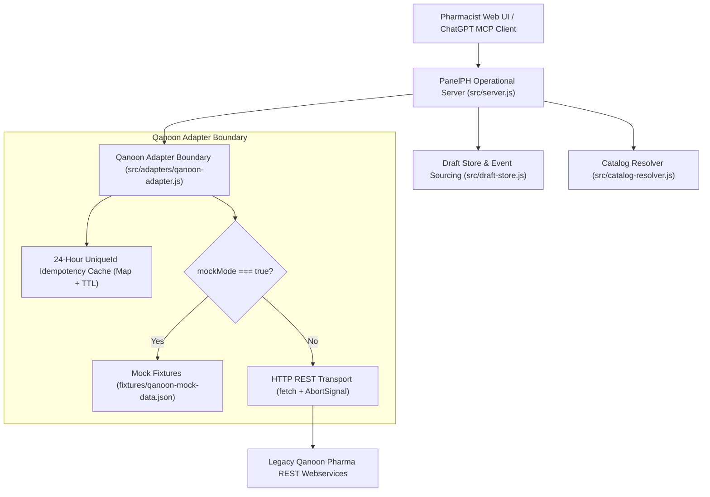

# Qanoon (قانون) Legacy REST Web-Service Specification

**Document Version:** 1.0.0  
**Target Component:** `src/adapters/qanoon-adapter.js`  
**Standard Status:** Production Interface Specification  
**Architecture Record:** `docs/adr/ADR-002-qanoon-authorized-source-access.md`

---

## 1. Architecture Overview & Isolation Boundary

PanelPH acts as an intelligent pharmacy operational desk and private ChatGPT MCP App. It bridges rapid, unstructured pharmacy counter entries with legacy pharmacy ERP and accounting systems (**قانون / Qanoon Pharma**).

### 1.1 Decoupled Boundary Architecture
Direct network coupling between the PanelPH domain core (`src/server.js`, `src/draft-store.js`, `src/catalog-resolver.js`) and legacy Qanoon HTTP wire protocols is strictly forbidden:
- All interactions with legacy Qanoon endpoints are encapsulated within `src/adapters/qanoon-adapter.js`.
- The adapter translates Qanoon wire schemas into normalized PanelPH domain structures and shields the domain from protocol changes, network anomalies, and legacy quirks.
- Raw Qanoon credentials, live production URLs, or unauthenticated tokens must never leak into application state, Git history, or client UI widgets.

### 1.2 Offline-First / Mock Mode Execution
To ensure 100% reproducible testing and developer workstation isolation without external network access:
- When running in test environments (`NODE_ENV === "test"`), when `mockMode: true` is configured, or when credentials (`QANOON_API_KEY`) are absent, `QanoonAdapter` executes 100% locally using `fixtures/qanoon-mock-data.json`.
- Zero outbound TCP sockets or HTTP fetch requests are dispatched in mock mode.
- In-memory mock operations execute identically to remote endpoints, including 24-hour idempotency validation, two-stage stock checks, and deterministic pricing.

### 1.3 System Architecture Diagram



---

## 2. Transport, Protocols & Authentication Headers

### 2.1 Transport Layer
- **Protocol:** HTTPS (or HTTP/1.1 over an encrypted VPN / private hospital LAN).
- **Encoding & Media Type:** `application/json; charset=utf-8`.
- **Default Port:** `8787` (internal proxy) / `443` (remote gateway).
- **Timeout Policy:** Client requests enforce a strict 5000ms timeout (`AbortSignal.timeout(5000)`). Sockets abort with typed `QanoonNetworkTimeoutError` upon expiration.

### 2.2 Standard Request Headers
All requests sent to the Qanoon REST gateway must supply standard metadata headers:

| Header Name | Type | Mandatory? | Description | Example |
|---|---|---|---|---|
| `Authorization` | String | Yes (Live) | Bearer token for pharmacy API access | `Bearer qan_live_8f3a92...` |
| `Content-Type` | String | Yes | Wire encoding format | `application/json; charset=utf-8` |
| `X-Pharmacy-Id` | String | Yes | National pharmacy license identifier | `PHARM-TEH-0084` |
| `X-Client-Id` | String | No | Client application tag | `panelph-desk` |
| `X-Request-Id` | String | Yes | Per-request UUIDv4 for distributed tracing | `c3b2f90a-1123-4d89-9e12-32a849f123bc` |
| `X-Unique-Id` | String | Yes (Mutating) | Stable client-generated idempotency token | `ord-draft-42-b3f89a-1728900000` |

---

## 3. Endpoint: Stock Availability Check (`POST /api/v1/stock/check`)

### 3.1 Two-Stage Stock Verification Lifecycle
PanelPH balances counter speed with inventory safety using a two-stage verification cycle:
1. **Stage 1 (Advisory Check):** Triggered asynchronously when resolving an unstructured draft need against catalog references. Advises the pharmacist via badges (`in_stock`, `low_stock`, `out_of_stock`) without blocking draft creation.
2. **Stage 2 (Pre-Export Barrier):** Triggered synchronously immediately prior to batch export. Evaluates all order rows against unexpired stock. Blocks submission if any line item exhibits shortage.

### 3.2 HTTP Route & Request Schema
- **Route:** `POST /api/v1/stock/check` (Alternative: `POST /stock/check`)

```json
{
  "$schema": "http://json-schema.org/draft-07/schema#",
  "title": "StockCheckRequest",
  "type": "object",
  "required": ["warehouseId", "items"],
  "properties": {
    "warehouseId": { "type": "string", "default": "main" },
    "items": {
      "type": "array",
      "minItems": 1,
      "items": {
        "type": "object",
        "required": ["quantity"],
        "properties": {
          "goodId": { "type": "string" },
          "genericCode": { "type": "string", "description": "National drug code preserving leading zeroes" },
          "brandCode": { "type": "string", "description": "Brand manufacturer code preserving leading zeroes" },
          "quantity": { "type": "integer", "minimum": 1 }
        }
      }
    }
  }
}
```

### 3.3 Response Schema — 200 OK
```json
{
  "warehouseId": "main",
  "checkedAt": "2026-10-14T09:30:00.000Z",
  "allAvailable": true,
  "items": [
    {
      "goodId": "g-1001",
      "genericCode": "00001",
      "brandCode": "00001",
      "requestedQuantity": 2,
      "availableCount": 140,
      "inStock": true,
      "stockStatus": "in_stock",
      "earliestExpDate": "2027-02-01",
      "avgCost": 132000,
      "advisoryWarning": null
    }
  ],
  "discrepancies": []
}
```

### 3.4 Operational Stock Status Rules
- `availableCount >= requestedCount`: `inStock = true`, `stockStatus = "in_stock"`, `advisoryWarning = null`.
- `0 < availableCount < requestedCount`: `inStock = false`, `stockStatus = "low_stock"`, `advisoryWarning = "موجودی ناکافی: موجود در انبار ${availableCount} عدد، درخواستی ${requestedCount} عدد"`.
- `availableCount === 0`: `inStock = false`, `stockStatus = "out_of_stock"`, `advisoryWarning = "کالا در انبار موجود نیست."`.
- Expired lots (`earliestExpDate < today`) are excluded from reservable inventory according to FEFO (First-Expired, First-Out).

---

## 4. Endpoint: Deterministic Price Calculation (`POST /api/v1/pricing/calculate`)

### 4.1 7-Step Deterministic Calculation Sequence
Official consumer prices are derived deterministically through 7 sequential phases:

```
[1: Base Unit Price]  --> [2: Base Extension]  --> [3: 75/25 Tax/Toll Split]
sellPrice || tempPrice    basePrice = P * Q        totalTax = Q * rate
                                                   vat = round(totalTax * 0.75)
                                                   toll = totalTax - vat
                                                                │
                                                                ▼
[6: Cost & Profit]    <-- [5: Final Price]     <-- [4: Technical Fee]
profit = final - cost     base + vat + toll + fee  15,000 * Q (pharma only)
                                                                │
                                                                ▼
                                                   [7: TTAC Divergence Guard]
                                                   if |TTAC - Qanoon| > 10,000 Rials:
                                                      emit warning; Qanoon price authoritative
```

### 4.2 Mathematical Invariants & Rounding
1. **Rounding Policy:** Supports `"round"` (`Math.round`), `"ceil"` (`Math.ceil`), and `"floor"` (`Math.floor`). Default is `"round"`.
2. **Tax/Toll Exact Sum Equality:**
   $$\text{totalTax} = \text{roundValue}(\text{quantity} \times \text{appliedTaxRate.averageTax}, \text{rule})$$
   $$\text{taxAmount (VAT)} = \text{roundValue}(\text{totalTax} \times 0.75, \text{rule})$$
   $$\text{tollAmount} = \text{totalTax} - \text{taxAmount}$$
   $$\text{taxAmount} + \text{tollAmount} \equiv \text{totalTax} \quad \text{(Invariant guaranteed without penny drift)}$$
3. **Technical Dispense Fee:**
   Applies to pharmaceutical products only. If `good.nonPharma === true`, technical fee evaluates to `0` and a notice is appended.
4. **TTAC Divergence Guard:**
   If $|\text{good.ttacPrice} - \text{unitBasePrice}| > 10{,}000\text{ Rials}$, a warning is attached:
   `"Price divergence: TTAC price (...) differs from Qanoon price (...) by more than 10,000 Rials."`
   The approved Qanoon price is authoritative and is never overridden by TTAC.

### 4.3 HTTP Route & Request Schema
- **Route:** `POST /api/v1/pricing/calculate` (Alternative: `POST /pricing/calculate`)

```json
{
  "goodId": "g-1001",
  "quantity": 2,
  "documentDate": "2026-06-24",
  "includeTechnicalFee": true,
  "roundingRule": "round",
  "warehouseId": "main"
}
```

### 4.4 Response Schema — 200 OK
```json
{
  "goodId": "g-1001",
  "unitBasePrice": 185000,
  "basePrice": 370000,
  "vatAmount": 13650,
  "taxAmount": 13650,
  "tollAmount": 4550,
  "totalTax": 18200,
  "technicalFee": 30000,
  "finalPrice": 418200,
  "avgCost": 264000,
  "profitAmount": 154200,
  "profitPercent": 58,
  "appliedTaxDate": "2026-01-01",
  "appliedTechnicalFeeDate": "2026-01-01",
  "warnings": []
}
```

---

## 5. Endpoint: Goods Catalog Search (`GET /api/v1/goods/search`)

### 5.1 Route & Query Parameters
- **Route:** `GET /api/v1/goods/search?q={query}&limit={limit}` (Alternative: `GET /goods/search`)
- **Query Parameters:**
  - `q` (string, required): Search query matching titles, generic codes, barcodes, or aliases.
  - `limit` (integer, optional, default: 20): Maximum number of returned goods.

### 5.2 Response Schema — 200 OK
```json
[
  {
    "goodId": "g-1001",
    "genericCode": "00001",
    "brandCode": "00001",
    "barcode": "6261001100011",
    "title": "Amoxicillin 500mg Capsule",
    "persianTitle": "آموکسی سیلین ۵۰۰ میلی گرم",
    "dosageForm": "کپسول",
    "strength": "۵۰۰ میلی‌گرم",
    "sellPrice": 185000,
    "tempPrice": 179000,
    "nonPharma": false
  }
]
```

### 5.3 Code String Integrity
All returned `genericCode` and `brandCode` attributes are strictly typed as `string`. Leading zeroes (e.g. `"00001"`, `"08234"`) are preserved in all JSON payloads.

---

## 6. Endpoint: Order Batch Reservation (`POST /api/v1/orders/batch`)

### 6.1 Architectural Idempotency Protection
Counter networks and automated retries can submit duplicate batch payloads. The adapter enforces client-driven idempotency keyed by `X-Unique-Id`:
- **Cache Duration:** 24 hours (`86,400,000 ms`).
- **Payload Fingerprint:** SHA-256 digest of normalized `{ draftId, warehouseId, items }`.
- **First Submission:** Processed and saved in cache, returning `status: "SUBMITTED"`, HTTP 201 Created (or 200 OK).
- **Exact Replay:** Resubmission with the identical `uniqueId` and identical payload returns original response with `status: "CACHED"` and `isIdempotentReplay: true`. No secondary batch is created.
- **Payload Divergence:** Resubmission of a seen `uniqueId` with altered quantities or items throws `409 Conflict` (`UNIQUE_ID_PAYLOAD_MISMATCH`).

### 6.2 HTTP Route & Request Schema
- **Route:** `POST /api/v1/orders/batch` (Alternative: `POST /orders/batch`)
- **Headers:** `X-Unique-Id: <uniqueId>`, `X-Pharmacy-Id: <pharmacyId>`

```json
{
  "draftId": "current-order-draft",
  "uniqueId": "ord-draft-42-b3f89a-1728900000",
  "warehouseId": "main",
  "notes": "Urgent morning replenishment",
  "items": [
    {
      "goodId": "g-1001",
      "genericCode": "00001",
      "brandCode": "00001",
      "quantity": 2,
      "price": 185000
    }
  ]
}
```

### 6.3 Response Schema — Initial Submission (201 / 200)
```json
{
  "success": true,
  "batchId": "QAN-ORD-1728900015000",
  "uniqueId": "ord-draft-42-b3f89a-1728900000",
  "timestamp": "2026-10-14T09:30:15.000Z",
  "status": "SUBMITTED",
  "isIdempotentReplay": false,
  "totalItems": 1,
  "items": [
    {
      "goodId": "g-1001",
      "genericCode": "00001",
      "quantity": 2,
      "price": 185000
    }
  ]
}
```

### 6.4 Response Schema — Replayed Submission within 24h
```json
{
  "success": true,
  "batchId": "QAN-ORD-1728900015000",
  "uniqueId": "ord-draft-42-b3f89a-1728900000",
  "timestamp": "2026-10-14T09:30:15.000Z",
  "status": "CACHED",
  "isIdempotentReplay": true,
  "totalItems": 1,
  "items": [
    {
      "goodId": "g-1001",
      "genericCode": "00001",
      "quantity": 2,
      "price": 185000
    }
  ]
}
```

---

## 7. Error Codes & Standard Error Format

All error responses from the Qanoon REST gateway follow a uniform envelope:

```json
{
  "error": "ERROR_CODE",
  "message": "Human-readable description of failure",
  "statusCode": 400,
  "details": null,
  "timestamp": "2026-10-14T09:30:15.000Z"
}
```

### 7.1 Standard Error Code Matrix

| HTTP Code | Error Code | Adapter Exception Class | Trigger Condition |
|---|---|---|---|
| `400` | `VALIDATION_ERROR` | `QanoonValidationError` | Missing `uniqueId`, empty items array, invalid quantity $\le 0$ |
| `401` | `UNAUTHORIZED` | `QanoonAuthenticationError` | Missing or invalid API key / bearer token |
| `403` | `FORBIDDEN` | `QanoonAuthenticationError` | Pharmacy license inactive or unauthorized warehouse |
| `404` | `NOT_FOUND` | `QanoonNotFoundError` | Requested `goodId` or warehouse does not exist |
| `409` | `CONFLICT` / `UNIQUE_ID_PAYLOAD_MISMATCH` | `QanoonConflictError` | Resubmission of seen `uniqueId` with altered items/payload |
| `409` / `425` | `CONCURRENT_REQUEST_IN_FLIGHT` | `QanoonConflictError` | Simultaneous requests received for identical in-flight `uniqueId` |
| `422` | `INSUFFICIENT_STOCK` | `QanoonValidationError` | Pre-batch inventory barrier check failed |
| `500` | `SERVER_ERROR` | `QanoonServerError` | Internal Qanoon ERP database or transaction failure |
| `504` | `TIMEOUT` | `QanoonNetworkTimeoutError` | Socket or request exceeded `timeoutMs` (5000ms) |

---

## 8. Leading-Zero String Preservation Invariant

### 8.1 National Drug List Encoding Rules
Under Iranian pharmaceutical standards:
- Generic codes (`genericCode`, e.g., `"00001"`, `"00025"`, `"08234"`) indicate active molecule identities in the Food and Drug Administration (FDA / سازمان غذا و دارو) Drug Formulary.
- Brand codes (`brandCode`, e.g., `"00001"`, `"00012"`) identify authorized pharmaceutical manufacturers.
- Barcodes (`barcode` / `gtin`, e.g., `"6261001100011"`) represent GS1 identifiers.

### 8.2 Defensive Invariants in PanelPH
1. **Never Coerce to Number:** Coercing `"00001"` via `Number()`, `+`, or `parseInt()` collapses the identifier to `1`, breaking foreign-key matching against catalog databases.
2. **Schema Enforcement:** All input and output schemas enforce `z.string()` or string primitives.
3. **Safe String Normalization:** The adapter sanitizes inputs via `String(code).trim()` and preserves leading zeroes throughout caching, serialization, and comparison logic.
